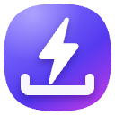
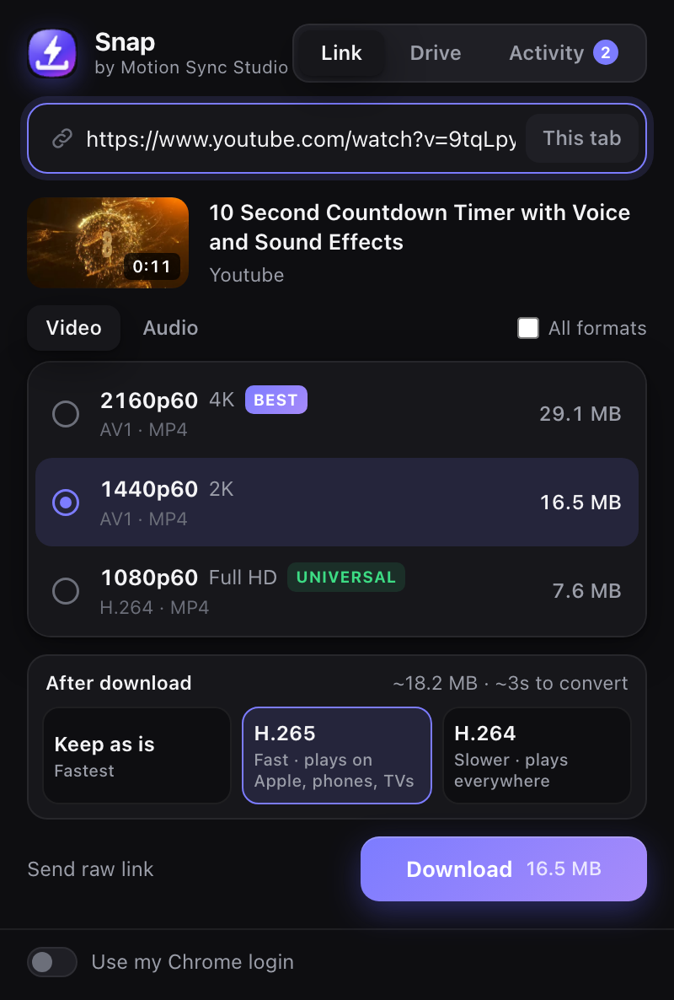
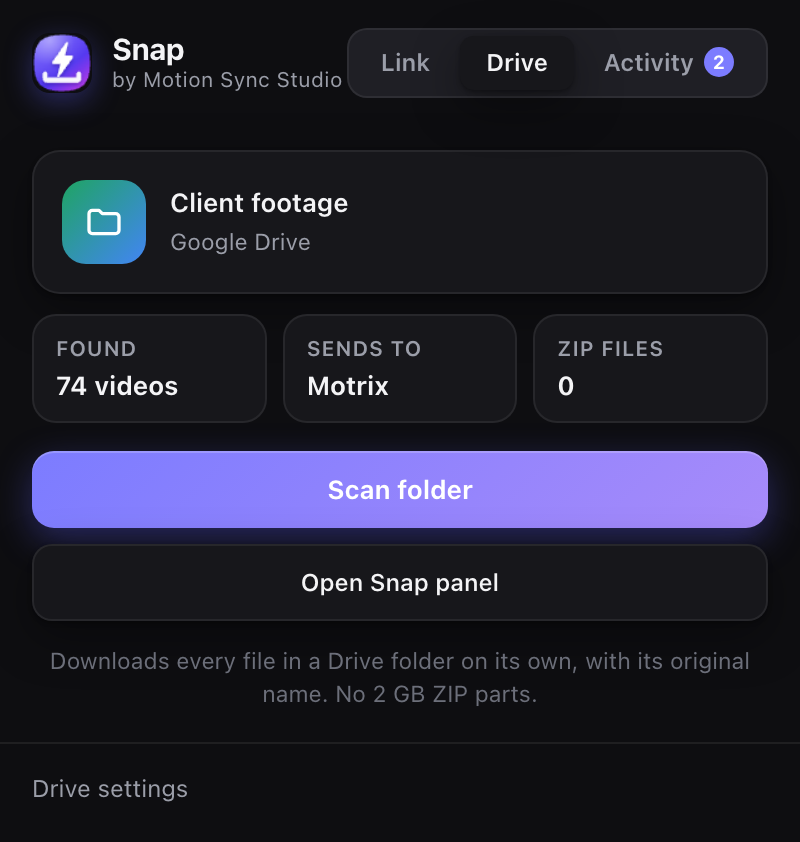
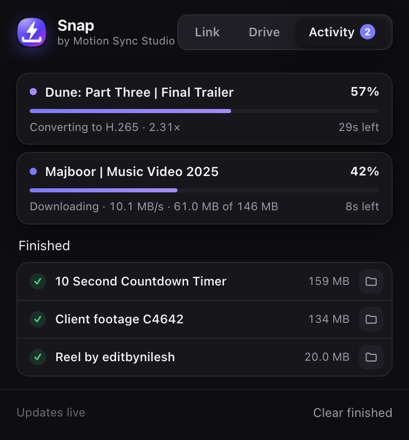

<p align="center">
  
</p>

<h1 align="center">Snap by Motion Sync Studio</h1>

<p align="center">
  A Chrome extension for macOS that downloads videos from YouTube, Facebook, Instagram and 1,000+ other sites in the quality you choose, and whole Google Drive folders as separate files instead of ZIPs. Downloads go to <a href="https://motrix.app">Motrix</a>.
</p>

<p align="center">
  
  
  
  
</p>

<p align="center">
  
  
  
</p>

---

## Contents

- [Features](#features)
- [Requirements](#requirements)
- [Install](#install)
- [How to use](#how-to-use)
- [Settings](#settings)
- [Troubleshooting](#troubleshooting)
- [How it works](#how-it-works)
- [Privacy and permissions](#privacy-and-permissions)
- [Updating and uninstalling](#updating-and-uninstalling)
- [Project structure](#project-structure)
- [Disclaimer](#disclaimer)
- [বাংলায় সংক্ষেপে](#বাংলায়-সংক্ষেপে)

---

## Features

### 🎬 Link: videos from social media and the web

- **Works on 1,000+ sites**, including YouTube, Facebook, Instagram (reels and posts), X/Twitter, TikTok and Vimeo, through [yt-dlp](https://github.com/yt-dlp/yt-dlp).
- **Lists every quality** with its resolution (4K, 2K, Full HD…), frame rate, codec, file type and **exact size** before you download.
- **Best** marks the top quality. **Universal** marks H.264, which plays everywhere. **HDR** marks HDR video.
- **Always MP4**, with AAC audio. Pick **All formats** if you want WEBM, VP9 and the rest.
- **Audio only**: M4A (AAC).
- **Auto-paste**: copy a link, click the Snap icon, and the qualities are already loading.
- **High quality gets joined automatically.** YouTube serves video and audio separately above 360p. Snap has Motrix download both, then joins them into one MP4 and deletes the pieces.
- **Optional conversion after download**, using your Mac's hardware encoder:
  - **Keep as is**: fastest.
  - **H.265**: about 1.7× faster than H.264 and a smaller file. Plays on Apple devices, phones, smart TVs and Windows 10/11.
  - **H.264**: plays everywhere, including older players and editors.
  - Snap shows the estimated final size and conversion time before you start.
- **Fast downloads.** Snap requests YouTube streams the way YouTube's own player does, so they aren't throttled. A 146 MB 4K video downloads in about 15 seconds on a fast connection.
- **Private posts.** Turn on **Use my Chrome login** for Facebook and Instagram posts that need you to be signed in.
- **Plain file links** (ZIP, PDF, DMG…) go straight to Motrix.
- **Right-click menu** on any link, video, image or page: *Snap: download best quality* or *Snap: download audio only*.

### 📁 Drive: Google Drive folders without ZIPs

- Google zips folder downloads into 2 GB parts (`drive-download-001.zip`…). Snap downloads **each file on its own, with its original name** (`C4642.MP4`, `C4641.MP4`…).
- **Scan folder** lists everything, including subfolders. You can filter by **Videos, Images, Audio, Documents**, and select all or some.
- **Keeps the folder structure** inside your download folder (`Downloads/Client footage/Day 01/C001.MP4`), in Motrix as well.
- **Works with Motrix** directly. It also works with IDM, FDM, JDownloader and others through their browser extensions, or with Chrome's own downloader.
- Downloads 1, 2, 3 or 5 files at a time. **Retries automatically** after network drops, and has a **Retry failed** button.
- **Google Docs, Sheets and Slides** export as `.docx`, `.xlsx` and `.pptx` (you can change the format).
- **No setup.** It uses the Google account you're already signed into in Chrome. Restrictions set by the file's owner are respected.

### 📊 Activity: live progress

- Every download shows a progress bar, %, speed, MB done and **time left**.
- Shows which step a job is on: Download → Join or Convert → Done.
- The **toolbar icon shows the %** while a job runs, and ✓ when it's done.
- **Show in Finder** for finished files. A macOS notification appears when each one is ready.

---

## Requirements

| What | Why | Get it |
|---|---|---|
| **macOS** (Apple Silicon or Intel) | The helper uses macOS tools (notifications, hardware video encoder) | |
| **Google Chrome** (or Brave, Edge, Arc, Chromium) | Runs the extension | [google.com/chrome](https://www.google.com/chrome/) |
| **Motrix** | Does the downloading | [motrix.app](https://motrix.app) |
| **Homebrew** | Installs yt-dlp and ffmpeg | [brew.sh](https://brew.sh) |
| **yt-dlp** and **ffmpeg** | Find video links, join video and audio, convert | installed by `install.sh` |
| **Python 3** | Runs the small helper | comes with macOS |

The **Drive** tab works without the helper. The **Link** tab and sending Drive folders to Motrix with their folder structure need it.

---

## Install

### 1. Get the code

```bash
git clone https://github.com/YOUR-USERNAME/snap-motion-sync-studio.git ~/Applications/Snap
```

Or download the ZIP from GitHub and unzip it.

> ⚠️ **Keep the folder somewhere permanent, on your Mac's internal drive.** Chrome runs the extension straight from this folder. If you move or delete it, or it's on an external drive that's unplugged, Snap stops working. `~/Applications/Snap` is a good place. Avoid Downloads and the Desktop.

### 2. Install Motrix and open it once

Download it from [motrix.app](https://motrix.app). Snap reads Motrix's settings (RPC port and secret) automatically, so you don't need to configure anything.

### 3. Run the installer

```bash
cd ~/Applications/Snap
./install.sh
```

This:
- installs **yt-dlp** and **ffmpeg** with Homebrew, if they're missing
- copies the helper to `~/Library/Application Support/Snap by Motion Sync Studio/`
- registers the helper with Chrome, Brave, Edge, Arc and Chromium, so they're allowed to talk to it

### 4. Load the extension in Chrome

1. Open `chrome://extensions`.
2. Turn on **Developer mode** (top right).
3. Click **Load unpacked** and choose the Snap folder (the one with `manifest.json` in it).
4. Click the puzzle-piece icon in the toolbar and **pin** Snap.
5. Reload any Google Drive tabs that are already open.

> If you used the older **noZIP** or **MotrixGrab** extensions, remove them first. Snap replaces both, and shares noZIP's extension ID.

### 5. Check it works

Copy a YouTube link and click the Snap icon. You should see the video's title and a list of qualities. If you see *"Can't reach the Snap helper"*, run `./install.sh` again and reload Snap.

---

## How to use

### Download a video

1. Copy a video link and click the **Snap** icon. The link is picked up automatically. You can also paste it, or click **This tab**.
2. Choose **Video** or **Audio**, then pick a quality.
3. For 4K and 2K (which YouTube only offers as AV1 or VP9), choose what happens **after download**: *Keep as is*, *H.265* or *H.264*.
4. Click **Download**. Snap switches to the **Activity** tab so you can watch the progress.

Tip: double-click a quality to download it straight away.

### Download a Google Drive folder

1. Open the folder in Google Drive.
2. Click the **Snap** icon, then **Scan folder**. Or use the Snap panel that appears on the Drive page.
3. Select files: tick them one by one, use **Select videos** or **Select all**, or **Use Drive selection** to take whatever you've highlighted in Drive.
4. Click **Download selected**. Files arrive in `Downloads/<folder name>/`, with their original names.

### Right-click

Right-click any link, video, image or page and choose **Snap: download best quality** or **Snap: download audio only**.

---

## Settings

| Where | Setting | What it does |
|---|---|---|
| Popup → Link | **Use my Chrome login** | Lets Snap use your Chrome login for private Facebook and Instagram posts. The first time, macOS asks to allow access to "Chrome Safe Storage". |
| Popup → Link | **All formats** | Shows every format (WEBM, VP9, Opus…), not just the best one per resolution |
| Popup → Link | **After download** | Keep as is / H.265 / H.264. Snap remembers your choice. |
| Drive panel | **Keep folders** | Recreates the Drive folder structure inside your download folder |
| Drive panel | **Parallel** | How many files download at once (1, 2, 3, 5) |
| Drive panel | **Subfolders** | Whether to scan folders inside the folder too |
| Drive settings | **If a file already exists** | Replace it, or keep both by adding (2) |
| Drive settings | **Google Docs formats** | Export format for Docs, Sheets, Slides and Drawings |
| Drive settings | **Advanced: Google connection** | Use the Google Drive API with your own Client ID (see below) |

Downloads are saved to **Motrix's download folder** (Motrix → Preferences → Basic → Default folder).

<details>
<summary><b>Advanced: Google Drive API mode (optional)</b></summary>

You don't need this. It's a backup in case the normal mode can't read a particular folder. Go to Drive settings → **Advanced: Google connection** → **Google Drive API with my own Client ID**. You'll need a free Client ID from Google Cloud:

1. <https://console.cloud.google.com/projectcreate>: create a project.
2. <https://console.cloud.google.com/apis/library/drive.googleapis.com>: click **Enable**.
3. <https://console.cloud.google.com/auth/overview>: set up the consent screen as **External**, then add your own email under **Audience → Test users**.
4. <https://console.cloud.google.com/auth/clients>: create a client of type **Web application**, with Authorized redirect URI `https://mhbmjoakklalifefkhfpamikchhhbbef.chromiumapp.org/`
5. Paste the Client ID into the settings and click **Save and sign in**. Click "Continue" on Google's "unverified app" warning. That's expected for a personal app.

</details>

---

## Troubleshooting

| What you see | What to do |
|---|---|
| **"Can't reach the Snap helper"** | Run `./install.sh` in the Snap folder, then reload Snap in `chrome://extensions`. |
| A site worked before but now fails | Sites change often. Update yt-dlp with `brew upgrade yt-dlp`. |
| **"Login required"** or an empty result on Instagram or Facebook | Turn on **Use my Chrome login** and try again. |
| Changes don't show up after an update | Click reload ↻ on Snap in `chrome://extensions`. Chrome keeps running the old code until you do. |
| Drive files arrive without their folders | Reload Snap (it needs the *cookies* permission), and check that **Keep folders** is on. If the helper can't be used, the panel says why. |
| Motrix shows two downloads for one video | That's normal for high quality. Video and audio download separately and Snap joins them. The pieces are named `… [video, joins automatically]` and are deleted afterwards. |
| A 4K file won't play in QuickTime | Choose **H.265** or **H.264** under *After download*, or open it in [IINA](https://iina.io) or VLC. |
| A Drive file says **Blocked** | The owner turned off downloading, or your account doesn't have access. Snap respects that. |
| **"Google's download limit for this file has been reached"** | Google limits downloads of very popular shared files. Try again later. |
| Chrome asks where to save every Drive file | In `chrome://settings/downloads`, turn off **Ask where to save each file**. |
| Snap disappeared from Chrome | The Snap folder was moved, deleted or is on an unplugged drive. Put it back, or load it again from its new place. |

The helper's log is at `~/Library/Logs/Snap.log`.

---

## How it works

```
┌──────────────── Chrome ────────────────┐        ┌──────── your Mac ────────┐
│ Snap popup ─── Link / Drive / Activity │        │                          │
│ Drive panel (content script)           │ native │  snap_host.py            │
│ Service worker (queue, right-click)    │◀──────▶│   ├─ yt-dlp: find streams│
└────────────────────────────────────────┘ messag.│   ├─ Motrix RPC: download│
                                                  │   └─ ffmpeg: join/convert│
                                                  └──────────────────────────┘
```

- **Link:** the helper runs `yt-dlp -J` to list the streams. When you pick one, the stream URLs go to Motrix over its aria2 RPC. YouTube streams are requested with `&range=`, which avoids throttling, and Snap waits for each link's `available_at` time so the request isn't refused. A small background job follows the Motrix downloads, then runs `ffmpeg`: a stream copy to join, or `h264_videotoolbox` / `hevc_videotoolbox` to convert. It writes its progress to `jobs/*.json`, which the popup reads.
- **Drive:** the panel reads the folder through Drive's own folder view, using your existing login. For each file it makes a 1-byte request to get Google's exact file name and size. With Motrix, the file goes to Motrix with its folder path and your Chrome login cookie. Otherwise it starts as a normal Chrome download, which a download manager can take over. There's no archive code anywhere, so **no ZIP is ever created**.

---

## Privacy and permissions

Snap has **no server and no analytics**. Nothing leaves your Mac except the requests to the sites you download from.

| Permission | Used for |
|---|---|
| `nativeMessaging` | Talking to the local helper (`snap_host.py`) |
| `downloads` | Chrome downloads for Drive, when Motrix isn't used |
| `cookies` | Passing your Google login to Motrix for Drive files. It's only sent to Motrix on your own Mac. |
| `clipboardRead` | Auto-filling a link you've copied when you open the popup |
| `contextMenus`, `notifications`, `activeTab`, `storage` | Right-click menu, alerts, "This tab", and remembering your settings |
| `management` (read-only) | Detecting an installed download manager extension |
| `identity` | Only for the optional Google Drive API mode |
| Site access | Google Drive and Docs download hosts, and `www.googleapis.com` |

**Use my Chrome login** lets yt-dlp read your Chrome cookies on your Mac. They're used only for the site you're downloading from.

---

## Updating and uninstalling

**Update**

```bash
cd ~/Applications/Snap && git pull && ./install.sh
```

Then click reload ↻ on Snap in `chrome://extensions`.

**Uninstall**

1. Click **Remove** on Snap in `chrome://extensions`.
2. Remove the helper:
   ```bash
   rm -rf ~/Library/Application\ Support/Snap\ by\ Motion\ Sync\ Studio
   rm -f ~/Library/Application\ Support/*/NativeMessagingHosts/com.motionsync.snap.json ~/Library/Application\ Support/*/*/NativeMessagingHosts/com.motionsync.snap.json
   ```
3. Delete the Snap folder.

---

## Project structure

```
manifest.json
install.sh                       installs the helper, yt-dlp and ffmpeg
host/snap_host.py                native helper: yt-dlp, Motrix RPC, ffmpeg, progress jobs
icons/                           app icon (snap.svg is the source)
docs/screenshots/                images used in this README
src/
  popup/                         toolbar popup: Link, Drive, Activity
  background/service-worker.js   Drive scanning, download queue, retries
  social/menus.js                right-click menu, toolbar progress badge
  content/content.js             floating panel on Google Drive (Shadow DOM)
  options/                       Drive settings page
  core/
    session.js                   per-file check: exact name, size, permission
    managers.js                  detects download manager extensions
    auth.js, drive-api.js        optional Google Drive API mode
    file-types.js, paths.js      file categories, safe file and folder names
    settings.js                  defaults and storage
```

---

## Disclaimer

Snap is a personal tool. Only download content you have the right to download: your own uploads, content with a permissive license, or content the owner allows you to save. Respect copyright and the terms of service of each site. Snap never bypasses DRM or the download restrictions a Google Drive owner has set. The authors are not responsible for how it's used.

Snap is not affiliated with YouTube, Google, Meta, Motrix or yt-dlp.

---

## বাংলায় সংক্ষেপে

**Snap কী করে:** YouTube, Facebook, Instagram সহ ১,০০০+ সাইট থেকে আপনার পছন্দের quality-তে ভিডিও Motrix দিয়ে ডাউনলোড করে। আর Google Drive-এর পুরো ফোল্ডার ZIP ছাড়াই, প্রতিটা ফাইল আলাদা আলাদা আসল নামে নামায়।

**Install:**
1. [Motrix](https://motrix.app) আর [Homebrew](https://brew.sh) install করুন।
2. এই repo-টা Mac-এর ভেতরের disk-এ একটা স্থায়ী জায়গায় রাখুন (যেমন `~/Applications/Snap`)। Downloads বা external drive-এ রাখবেন না।
3. Terminal-এ ফোল্ডারটায় গিয়ে `./install.sh` চালান।
4. `chrome://extensions` → **Developer mode** অন করুন → **Load unpacked** → Snap ফোল্ডার বাছুন।

**ব্যবহার:**
- **ভিডিও:** লিংক কপি করুন → Snap আইকনে ক্লিক করুন → quality বাছুন → **Download**।
- **Drive:** ফোল্ডার খুলুন → Snap → **Scan folder** → ফাইল বাছুন → **Download selected**।
- **Progress:** **Activity** tab-এ, আর toolbar আইকনের ওপর % দেখায়।

**সমস্যা হলে:** `brew upgrade yt-dlp` চালান, আর `chrome://extensions` এ Snap reload করুন।

---

## License

[MIT](LICENSE) © Motion Sync Studio

Built on [yt-dlp](https://github.com/yt-dlp/yt-dlp), [FFmpeg](https://ffmpeg.org) and [Motrix](https://motrix.app).
